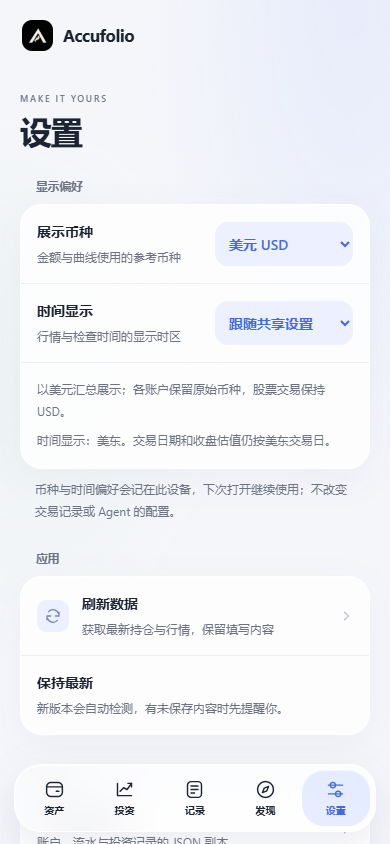

<div align="center">
  
  <h1>Accufolio</h1>
  <p><strong>Agent-driven asset allocation.</strong></p>
  <p>A self-hosted dashboard. Let your agent maintain the data; see your allocation clearly.</p>
  <p>
    <a href="https://github.com/zuquanzhi/Accufolio/actions/workflows/ci.yml"></a>
    <a href="https://github.com/zuquanzhi/Accufolio/releases/latest"></a>
    <a href="LICENSE"></a>
  </p>
  <p><a href="#how-it-works">How it works</a> · <a href="#quick-start">Quick start</a> · <a href="guides/使用与部署.md">Deployment & MCP guide</a> · <a href="https://github.com/zuquanzhi/Accufolio/releases">Releases</a> · <a href="README.md">简体中文</a></p>
</div>

---

Accufolio is a single-user, self-hosted asset allocation dashboard. Named accounts describe where money is held and what it is for. Your agent maintains cash entries and securities transactions through MCP; balances, allocation, and returns are derived from those records.

Asset and transaction data is read-only in Web, PWA, and Android, backed by your own SQLite database. Accufolio provides MCP tools and visualization. You choose and run the agent; the app does not include an AI model or a chat service.

## Preview


<details>
<summary>More views: allocation, strategy curves, monitoring, and mobile access</summary>
<br>




</details>

The device frames are illustrative; the screenshots show the running application with synthetic transactions and prices in an isolated database. The mobile images show the responsive web interface; the Android client displays the same interface after connecting to a server; the welcome screen is captured on an Android 15 emulator.

## Assets and investments

| Page | Purpose |
|---|---|
| **Assets** | Default home: net assets, named accounts, cash balances, and account allocation. Open an account to inspect its journal. |
| **Investments** | Securities holdings, realized and unrealized gains, historical curves, and separate allocation/performance details. |
| **Records** | Completed securities trades with account, currency, fees, and strategy. |
| **Discover** | Four contribution strategies, movement alerts, calm signals, and optional Webhooks. |
| **Settings** | Display currency, timezone, login, backups, connection, and updates. |

Cash balances sum journal entries; securities are calculated per account and symbol before aggregation. Targets store weights only. Choose USD, CNY, HKD, or EUR: current values use the latest reference rate, while historical points use rates published by that date. Missing quotes or exchange rates remain unavailable.

## How it works

Your agent reads accounts and records, previews completed operations, and commits through local MCP to the same SQLite database used by the Web service. Web, PWA, and Android provide read-only asset views. Accufolio does not include an AI model or chat service.

Account, cash, trade, target, and shared-setting writes default to a preview. Committing requires `ACCUFOLIO_MCP_SCOPE=write` and `dry_run=false`, with revision checks, idempotency keys, and audit records where applicable.

> Read my accounts and preview this salary deposit, preserving its original currency and date.

> Prepare this completed US stock purchase: confirm its brokerage account, amount, fee, and strategy, then reconcile the trade and actual cash movement separately.

**Trades do not automatically settle cash.** Record actual cash movements separately; never infer opening balances from trades. Dedicated transfer tools record both account or FX legs atomically. MCP requires local access to the same database; there is no remote MCP endpoint. See the [MCP guide](guides/使用与部署.md#mcp-接入).

## Calculation basis

Net assets combine securities values and account cash balances in one currency; liabilities are not modeled. Moving-average securities cost includes transaction fees. XIRR explicitly measures USD securities trade cash flows; account interest and cash dividends are not automatically included.

Latest quotes and historical closes show separate timestamps. History uses same-day unadjusted closes from completed US Eastern trading sessions, retaining gaps. It is not complete account NAV. ECB historical rates are stored by date and never replaced by today's rate when converting the past. See the [data model and calculations](guides/schema-v2.md).

## Quick start

Use Docker Compose, or Python 3.11–3.13. For a new deployment:

```bash
git clone https://github.com/zuquanzhi/Accufolio.git
cd Accufolio
cp .env.example .env
# Set a strong, unique ACCUFOLIO_PASSWORD in .env
docker compose up -d --build
```

Visit <http://127.0.0.1:8000> and sign in as `admin` with your password. The container binds to localhost. A new database receives the final schema and one empty USD brokerage account, without sample balances, trades, or exchange rates.

Configure your agent using the [MCP guide](guides/使用与部署.md#mcp-接入). Its `ACCUFOLIO_DB` must point to the Web service's database. Start with `list_accounts`, `get_assets`, and `get_dashboard`, then preview data changes.

**2.0 uses a new account and cash-journal model.** [sql/schema.sql](sql/schema.sql) defines the final schema. Existing databases must be backed up and adapted by the operator; the app does not infer, migrate, or rewrite legacy records. Incompatible databases are rejected. See the [deployment guide](guides/使用与部署.md).

## Mobile and updates

| Option | Getting started |
|---|---|
| **Android 10+** | Download the `.apk` from the [latest release](https://github.com/zuquanzhi/Accufolio/releases/latest), install it, and enter your HTTPS server address. |
| **PWA** | Open your HTTPS site on Android or iOS and install it or add it to the home screen. |

Both require a server; the APK does not include the backend. Web changes are detected after server updates, protecting unsaved input. Native updates can be downloaded and verified in-app before Android requests installation confirmation. The source ZIP is not a mobile installer.

Remembered login lasts up to 90 days using a revocable token, never a stored password. Signing out revokes that session; changing the server password invalidates existing sessions. Remote access requires HTTPS. Set `ACCUFOLIO_PUBLIC_ORIGIN` for an existing reverse proxy; the included Caddy configuration sets it automatically.

## Data and scope

SQLite online backups and JSON data exports support data ownership. Automatic daily backups retain 30 copies by default. Worker heartbeat, failures, and delivery status are visible; retention protects undelivered notifications. MCP database permissions belong to its local process.

Current support covers USD US-stock trades, original-currency cash accounts, and four display currencies. Unsupported FX conversions remain unavailable. Cash entries can record interest, dividends, and fees; securities XIRR does not yet include cash dividends. Unadjusted history may be affected by splits. Broker execution, multiple users, remote MCP, and market-data redistribution are outside the current scope. Offline startup, complete account NAV, and liabilities are not implemented. See the [roadmap](guides/roadmap.md).

## Development

```bash
python -m venv .venv
# macOS / Linux: source .venv/bin/activate
# Windows PowerShell: .venv\Scripts\Activate.ps1
pip install -r requirements.txt
python -m unittest discover -s tests -v
```

CI is configured for Python, browser flows, Docker, and Android checks. Verified releases include a signed APK, source archive, and SHA-256 checksums. See [Actions](https://github.com/zuquanzhi/Accufolio/actions) for each commit's result, and [Issues](https://github.com/zuquanzhi/Accufolio/issues) for reports and suggestions.

## License

[Apache License 2.0](LICENSE)
