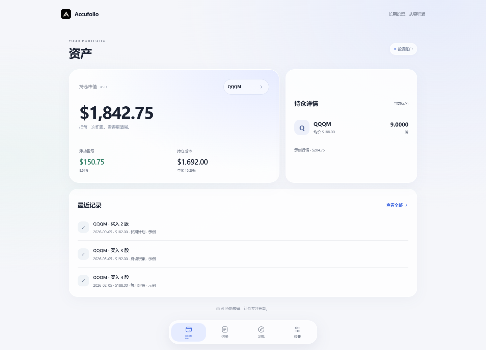

<div align="center">
  
  <h1>Accufolio</h1>
  <p><strong>Invest for the long term, one contribution at a time.</strong></p>
  <p>A self-hosted investment journal for tracking contributions and seeing your progress.</p>
  <p>
    <a href="https://github.com/zuquanzhi/Accufolio/actions/workflows/ci.yml"></a>
    <a href="https://github.com/zuquanzhi/Accufolio/releases/latest"></a>
    <a href="LICENSE"></a>
  </p>
  <p><a href="#quick-start">Quick start</a> · <a href="#mobile-access">Mobile access</a> · <a href="https://github.com/zuquanzhi/Accufolio/releases">Releases</a> · <a href="README.md">简体中文</a></p>
</div>

---

Accufolio is a single-user, self-hosted app for long-term investors. Record purchases, review your holdings, compare contribution strategies, and follow market prices from a browser, a PWA, or the Android client. Your ledger is stored in your own SQLite database.

## Preview

| Desktop web | Mobile web / PWA |
|:---:|:---:|
|  |  |

<details>
<summary>More views: backtesting, monitoring, mobile trades, and Android welcome screen</summary>
<br>


</details>

These screenshots show the running application with synthetic transactions and prices in an isolated database. The mobile images show the responsive web interface; the Android client displays the same interface after connecting to a server; the welcome screen is captured on an Android 15 emulator.

## Features

- **Investment journal:** record and edit purchases, with an audit trail and undo for changes.
- **Portfolio overview:** review contributions, shares, average cost, market value, profit and loss, and XIRR.
- **Strategy comparisons:** provide daily closing prices to compare four contribution strategies, including ending value, return, and the underlying price's maximum drawdown.
- **Price monitoring:** follow US securities with Sina quotes, set change thresholds, and see in-app alerts and data-source status.
- **Your data:** SQLite storage, daily and manual database backups, JSON trade export, and optional local MCP access that defaults to read-only.
- **Multiple devices:** access one self-hosted instance from desktop browsers, a mobile PWA, or the Android app.

## Quick start

Install [Docker and Docker Compose](https://docs.docker.com/get-docker/), then run:

```bash
git clone https://github.com/zuquanzhi/Accufolio.git
cd Accufolio
cp .env.example .env
# Edit .env and set a strong, unique ACCUFOLIO_PASSWORD
docker compose up -d --build
```

Visit <http://127.0.0.1:8000> and sign in with username `admin` and the password you set. There is no default password. The container binds to localhost by default and stores the database in a Docker volume.

Python 3.11–3.13 is also supported. For remote access, put the service behind HTTPS. The repository includes an optional Caddy configuration: set `ACCUFOLIO_DOMAIN` in `.env`, point DNS to your server, open ports 80 and 443, then run:

```bash
docker compose -f compose.yml -f compose.https.yml up -d --build
```

The [deployment and usage guide](guides/使用与部署.md) contains environment variables, backup and restore, MCP configuration, and backtest details (currently in Chinese).

## Mobile access

| Option | Requirements | Getting started |
|---|---|---|
| **Android APK** | Android 10 or later | Download the `.apk` from the [latest release](https://github.com/zuquanzhi/Accufolio/releases/latest), install it, and enter your server's HTTPS origin. |
| **PWA** | Android or iOS browser | Open your HTTPS site and use the browser's install or add-to-home-screen action. |

Both options require a deployed server; the APK does not include the backend. After the server is updated, web changes are detected and loaded automatically, with a prompt when there is unsaved input. Changes to the native Android client itself still require installing a new APK. The release source ZIP is for deployment and development, not an Android installer. SHA-256 checksum files are provided with release assets.

## How it works

```text
Browser / PWA / Android client
              │ HTTPS
              ▼
       FastAPI + web interface ── quote provider
              │
        SQLite database and backups
              ▲
       Local MCP client (optional)
```

The application uses HTTP Basic authentication. Use HTTPS for remote access and protect your password and database backups. MCP runs as a local process and is read-only by default; write access must be explicitly enabled.

## Scope and limitations

The current release focuses on a single-user, USD purchase ledger. It does not connect to a broker or place orders. Sales, dividends, fees, multiple currencies, broker sync, external notifications, and remote MCP are not supported. Quotes depend on a third party and may be delayed or unavailable. Backtests exclude costs, taxes, and dividends; historical results do not guarantee future returns.

## Development

```bash
python -m venv .venv
# macOS / Linux: source .venv/bin/activate
# Windows PowerShell: .venv\Scripts\Activate.ps1
pip install -r requirements.txt
python -m unittest discover -s tests -v
```

CI covers Python tests, browser flows, Docker startup, and Android checks. The release workflow produces a signed APK, a source archive, and checksum files after verification. See the [guide](guides/使用与部署.md) for browser and Android testing. Bug reports and suggestions are welcome via [Issues](https://github.com/zuquanzhi/Accufolio/issues).

## License

[Apache License 2.0](LICENSE)
