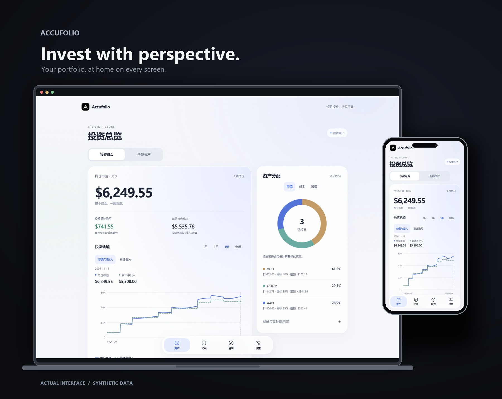
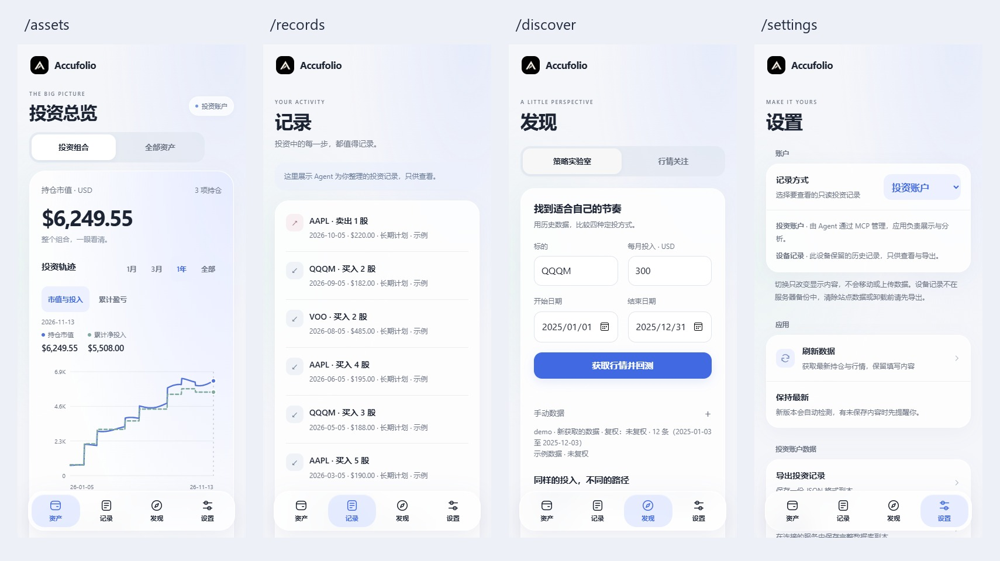
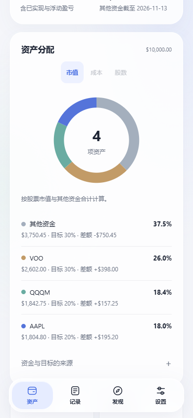
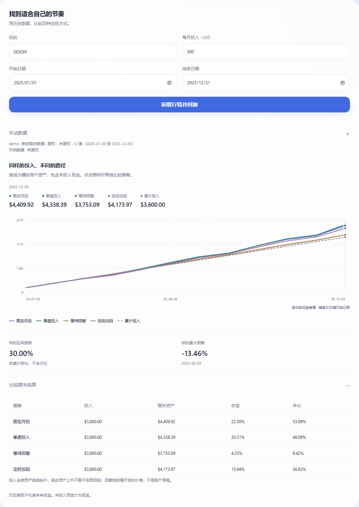
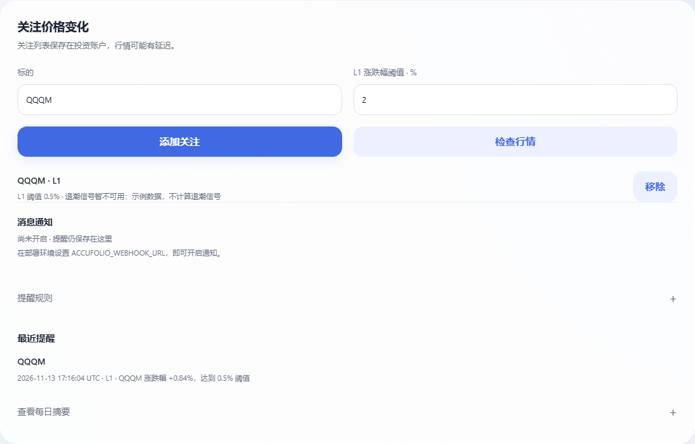
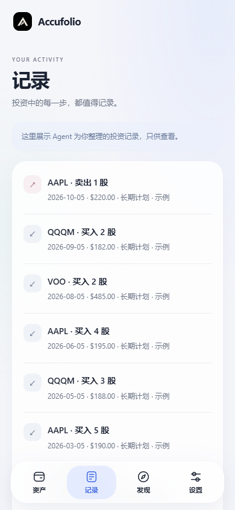
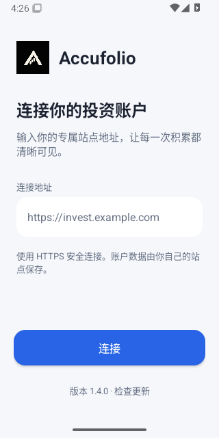

<div align="center">
  
  <h1>Accufolio</h1>
  <p><strong>Invest for the long term, one contribution at a time.</strong></p>
  <p>A self-hosted investment dashboard, with data maintained by AI and a clear view of assets, allocation, and progress.</p>
  <p>
    <a href="https://github.com/zuquanzhi/Accufolio/actions/workflows/ci.yml"></a>
    <a href="https://github.com/zuquanzhi/Accufolio/releases/latest"></a>
    <a href="LICENSE"></a>
  </p>
  <p><a href="#quick-start">Quick start</a> · <a href="#mobile-access">Mobile access</a> · <a href="https://github.com/zuquanzhi/Accufolio/releases">Releases</a> · <a href="README.md">简体中文</a></p>
</div>

---

Accufolio brings holdings across multiple securities, investment and profit curves, allocation targets, and strategy backtests into one dashboard. AI maintains transactions and allocation data through local MCP; the app provides a read-only view for analysis. Your data stays in your own SQLite database, accessible from a browser, a PWA, or the Android client.

## Preview



<details>
<summary>More views: backtesting, monitoring, mobile trades, and Android welcome screen</summary>
<br>







</details>

The device frames are illustrative; the screenshots show the running application with synthetic transactions and prices in an isolated database. The mobile images show the responsive web interface; the Android client displays the same interface after connecting to a server; the welcome screen is captured on an Android 15 emulator.

## Features

- **Portfolio overview:** aggregate market value, remaining cost, realized and unrealized gains, net investment, and XIRR across securities. View allocation by market value, cost, or share count.
- **Historical perspective:** explore holdings value, cumulative net investment, and cumulative profit over one month, three months, one year, or all records. Read individual dates using touch or keyboard controls.
- **Two allocation views:** the investment portfolio covers stock holdings; total assets add an independently reported other-funds balance and its as-of date. Compare market-value weights with separate allocation targets.
- **Strategy comparisons:** fetch cached daily prices and compare four strategy curves against cumulative contributions. Manual price input remains available; source and adjustment details are visible.
- **Price monitoring:** L1/L2/L3 movement alerts and a calm signal based on aligned stock and VIX closes. Missing or stale signal data is explicitly skipped.
- **External alerts:** optional JSON Webhooks with a persistent outbox, retries, and delivery status.
- **AI-maintained data:** MCP tools manage buys, sells, other funds, and targets. Write access requires explicit configuration and supports previews, audit history, and retry-safe changes.
- **Multiple devices:** access the same dashboard from desktop browsers, a PWA, or Android. Database backups and JSON exports are available; older on-device records remain available for read-only viewing and export.

## What the numbers mean

| View | Data and purpose |
|---|---|
| **Investment portfolio** | Current stock holdings, weighted by market value, remaining cost, or share count. Share weights compare quantities, not capital allocation. |
| **Total assets** | Current stock market value plus an independently reported other-funds balance, with its as-of date. Cash is never inferred from trades. |
| **Allocation targets** | Separate targets for the portfolio and total assets. Gaps use market value only; they do not create or execute orders. |
| **History** | Stock holdings reconstructed from transactions and unadjusted closing prices. Missing values remain gaps; today's other-funds balance is not inserted into history. This is not account NAV. |

Net investment equals cumulative purchases minus sale proceeds. Cumulative profit equals holdings value minus net investment. XIRR uses buys, sells, and terminal holdings value; short samples and cash flows without a unique supported solution show an explicit reason. See the [calculation and allocation guide](guides/使用与部署.md#看板与资产配置) for details (Chinese).

## Quick start

Install [Docker and Docker Compose](https://docs.docker.com/get-docker/), then run:

```bash
git clone https://github.com/zuquanzhi/Accufolio.git
cd Accufolio
cp .env.example .env
# Edit .env and set a strong, unique ACCUFOLIO_PASSWORD
docker compose up -d --build
```

Visit <http://127.0.0.1:8000> and sign in with username `admin` and the password you set. There is no default password. The container binds to localhost by default and stores the database in a Docker volume.

Python 3.11–3.13 is also supported. For remote access, put the service behind HTTPS. The repository includes an optional Caddy configuration: set `ACCUFOLIO_DOMAIN` in `.env`, point DNS to your server, open ports 80 and 443, then run:

```bash
docker compose -f compose.yml -f compose.https.yml up -d --build
```

The [deployment and usage guide](guides/使用与部署.md) contains environment variables, backup and restore, MCP configuration, and backtest details (currently in Chinese).

## Mobile access

Four routes organize the app: `/assets`, `/records`, `/discover`, and `/settings`. In-app navigation keeps the document and connection alive, preserving scroll position and analysis parameters. Each route also supports direct loading and refresh. Data-source selection, refresh, and Android connection/update controls live in Settings. Asset and transaction data is read-only in the interface and maintained through MCP. Older on-device records remain viewable and exportable, with no editing or upload.


| Option | Requirements | Getting started |
|---|---|---|
| **Android APK** | Android 10 or later | Download the `.apk` from the [latest release](https://github.com/zuquanzhi/Accufolio/releases/latest), install it, and enter your server's HTTPS origin. |
| **PWA** | Android or iOS browser | Open your HTTPS site and use the browser's install or add-to-home-screen action. |

Both options require a deployed server; the APK does not include the backend. After the server is updated, web changes are detected and loaded automatically, with a prompt when there is unsaved input. From v1.2.0, the Android app can check, download and verify updates in-app, then request system installation confirmation. Upgrading from an older version requires installing the new APK once. The release source ZIP is for deployment and development, not an Android installer. SHA-256 checksum files are provided with release assets.

## How it works

```text
Browser / PWA / Android client
              │ HTTPS
              ▼
       FastAPI + web interface ── quote provider
              │
        SQLite database and backups
              ▲
       Local MCP client (optional)
```

The application uses HTTP Basic authentication. Use HTTPS for remote access and protect your password and database backups. MCP runs as a local process and is read-only by default; write access must be explicitly enabled. Older device-local records stay in the current browser origin; they are not uploaded or included in server backups. Export them before clearing browser data or uninstalling the app. The server is still required to load the interface; independent offline startup is not supported.

## Scope and limitations

The current release focuses on a single-user, USD investment dashboard. It does not connect to a broker or place orders. Dividends, fees, multiple currencies, broker sync, and remote MCP are not supported. Other funds are a reported balance snapshot, not a complete cash ledger. Sina daily closes are unadjusted: splits can distort historical curves and backtests, and dividends are not reinvested. Stale data is visibly flagged. Webhooks use generic JSON and require a compatible receiver or adapter; set `ACCUFOLIO_WEBHOOK_URL` and optionally `ACCUFOLIO_WEBHOOK_TOKEN` in the deployment environment. Quotes may be delayed or unavailable; historical results do not guarantee future returns. Planned work and exclusions are tracked in the [roadmap](guides/roadmap.md).

## Development

```bash
python -m venv .venv
# macOS / Linux: source .venv/bin/activate
# Windows PowerShell: .venv\Scripts\Activate.ps1
pip install -r requirements.txt
python -m unittest discover -s tests -v
```

CI covers Python tests, browser flows, Docker startup, and Android checks. The release workflow produces a signed APK, a source archive, and checksum files after verification. See the [guide](guides/使用与部署.md) for browser and Android testing. Bug reports and suggestions are welcome via [Issues](https://github.com/zuquanzhi/Accufolio/issues).

## License

[Apache License 2.0](LICENSE)
