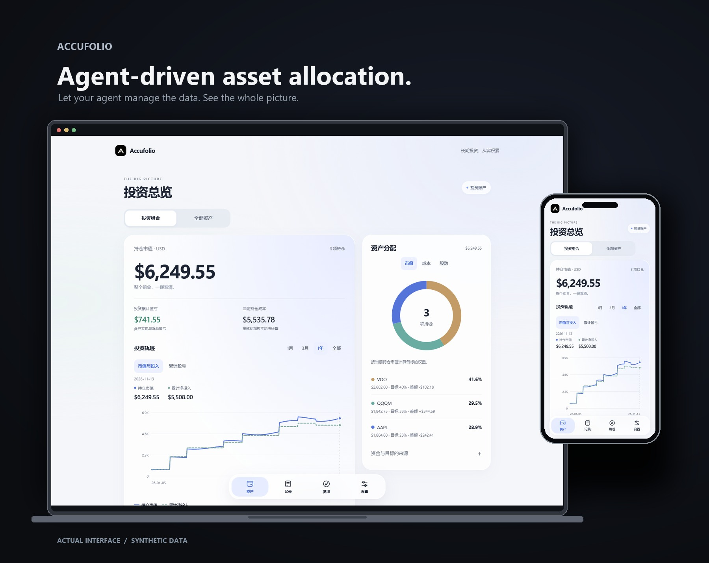
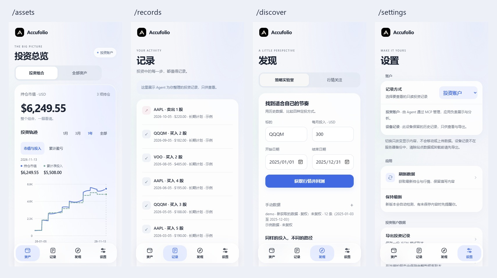
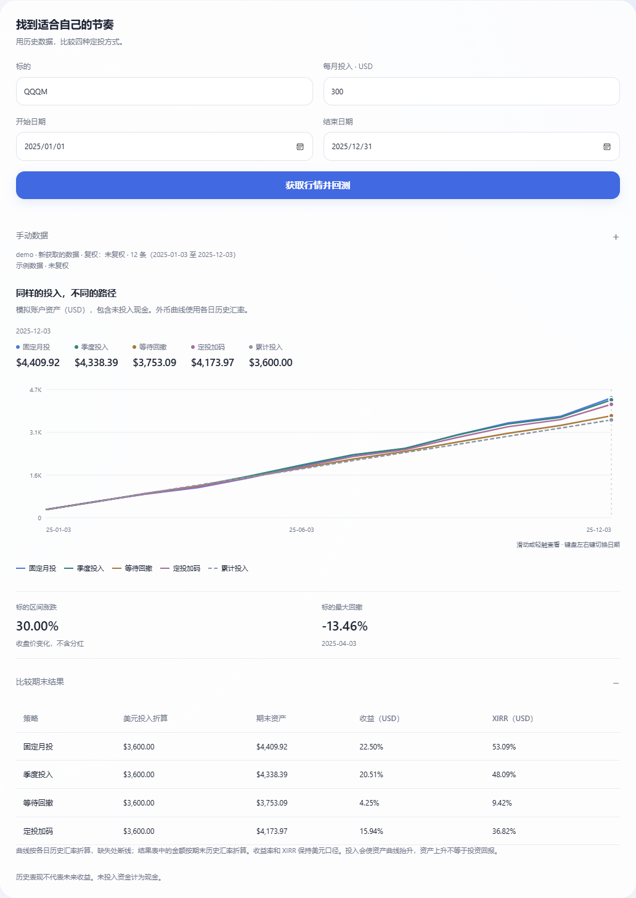
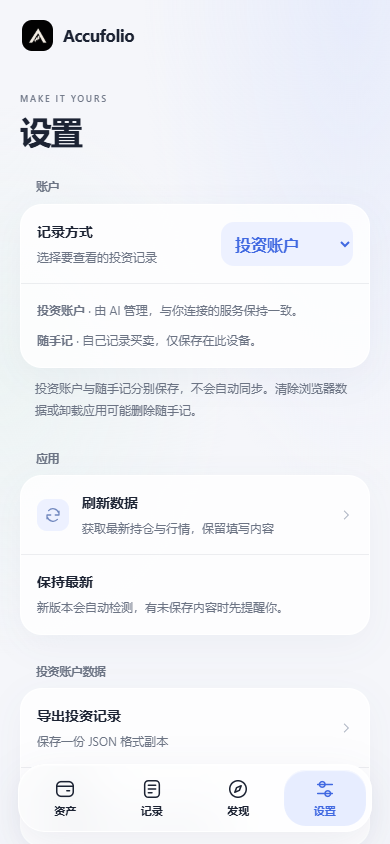

<div align="center">
  
  <h1>Accufolio</h1>
  <p><strong>Agent 驱动的资产配置看板</strong></p>
  <p>让 Agent 整理资产，用图表看清配置。</p>
  <p>
    <a href="https://github.com/zuquanzhi/Accufolio/actions/workflows/ci.yml"></a>
    <a href="https://github.com/zuquanzhi/Accufolio/releases/latest"></a>
    <a href="LICENSE"></a>
  </p>
  <p><a href="#工作方式">工作方式</a> · <a href="#快速开始">快速开始</a> · <a href="guides/使用与部署.md">部署与 MCP 指南</a> · <a href="https://github.com/zuquanzhi/Accufolio/releases">版本下载</a> · <a href="README.en.md">English</a></p>
</div>

---

Accufolio 是单用户、自托管的资产配置看板。你向自己的 Agent 提供已发生的交易、带日期的资金余额和配置目标；Agent 通过 MCP 整理并写入数据，Accufolio 将它们呈现为持仓分布、目标差额和长期曲线。

资产与交易记录在 Web、PWA 和 Android 中只读查看，数据保存在你自己的 SQLite 数据库。Accufolio 提供 MCP 工具与可视化界面；Agent 由你自行选择和运行，应用不内置 AI 模型或聊天服务。

## 产品预览



<details>
<summary>查看更多：资产配置、策略曲线、行情关注与移动端</summary>
<br>







</details>

宣传图使用实际运行界面截图和示意设备外框，交易与行情数据均为模拟数据。手机图展示响应式网页，Android 客户端连接服务器后展示同一界面；欢迎页来自 Android 15 模拟器。

## 配置一目了然

- **Agent 维护资产** — 通过 MCP 更新买卖记录、其他资金与目标比例。交易增删改与配置替换支持预览，提交受写权限控制，变更保留审计与幂等保护。
- **看清当前分布** — 多标的汇总市值、成本、已实现与浮动盈亏、净投入和 XIRR；环形图与持仓明细支持市值、成本和股数三种口径。
- **对照配置目标** — 为投资组合与全部资产分别设置目标，按市值查看当前比例和金额差额。
- **观察长期变化** — 市值、净投入和累计盈亏曲线支持时间区间切换、触摸与键盘读数；历史缺失保持断点。
- **验证投入策略** — 自动获取缓存日线，对比四种定投策略曲线和累计投入基线，展开查看期末结果。
- **持续关注行情** — L1/L2/L3 涨跌提醒、基于标的与 VIX 的退潮信号，以及支持失败重试的可选 Webhook 通知。

## 工作方式

```text
你提供交易、余额与目标
          │
          ▼
自己的 Agent / MCP 客户端
          │ 本地 stdio · 按权限读写
          ▼
    Accufolio MCP ──→ SQLite 数据库
                            │
    行情与日线 ──→ FastAPI 分析与 Web 界面
                            │ HTTPS
                            ▼
                   Web · PWA · Android
                    资产与交易记录只读
```

Agent 先读取现有记录与配置，再准备变更。交易增删改与配置替换默认 `dry_run=true`；提交这些操作需在 MCP 进程开启 `ACCUFOLIO_MCP_SCOPE=write`，并设置 `dry_run=false`。配置更新还需匹配当前版本号，避免覆盖刚发生的变更。

接好 MCP 后，可以这样向 Agent 提供已发生的交易、余额和目标：

> 请记录我已经完成的交易：2026-11-12 买入 QQQM 2 股，成交价每股 280 USD。先给我预览，确认后再提交。

> 截至 2026-11-14，我的其他资金余额为 5,000 USD。请读取现有配置，保留两份目标和备注，只替换余额及日期，先预览。

> 请预览这份配置：投资组合 QQQM 60%、SPY 40%；全部资产 QQQM 45%、SPY 30%、其他资金 25%。保留已填报的余额、日期和备注，确认后再提交。

资金余额由用户提供并由 Agent 显式更新。买入、卖出不会自动扣减或增加其他资金；工资、支出和转账也需要新的余额信息。MCP 目前是能访问同一数据库的本地 stdio 进程，**不是远程 MCP 服务**，手机端只连接 Web 站点。完整配置见 [MCP 接入指南](guides/使用与部署.md#mcp-接入)。

## 资产视角与计算口径

| 视图 | 数据与用途 |
|---|---|
| **投资组合** | 当前股票持仓，可按市值、剩余成本或股数查看占比。股数占比只比较数量，不代表资金权重。 |
| **全部资产** | 当前股票市值 + Agent 独立填报的 USD 其他资金余额，保留余额截至日期；未提供的余额显示未知，不默认为零。 |
| **配置目标** | 投资组合与全部资产分别维护目标，仅按市值计算比例和金额差额，不生成或执行订单。 |
| **历史曲线** | 用交易记录与未复权收盘价重建股票持仓；缺失数据留空，不将当前其他资金倒填历史，也不称为账户净值。 |

净投入为累计买入金额减累计卖出金额，累计盈亏为当前持仓市值减净投入。XIRR 纳入买入、卖出与期末持仓价值；样本不足或没有唯一可用解时明确显示原因。详细公式和边界见[看板与资产配置指南](guides/使用与部署.md#看板与资产配置)。

## 快速开始

先部署看板，再连接能够访问同一数据库的 Agent。使用 [Docker 和 Docker Compose](https://docs.docker.com/get-docker/) 启动服务：

```bash
git clone https://github.com/zuquanzhi/Accufolio.git
cd Accufolio
cp .env.example .env
# 编辑 .env，设置唯一且足够强的 ACCUFOLIO_PASSWORD
docker compose up -d --build
```

打开 <http://127.0.0.1:8000>，使用默认用户名 `admin` 和刚设置的密码登录。没有默认密码或示例资产。容器默认只监听本机，数据库保存在 Docker 卷中。

然后按 [MCP 接入指南](guides/使用与部署.md#mcp-接入)，让自己的 MCP 客户端启动 `scripts/mcp_server.py`。MCP 的 `ACCUFOLIO_DB` 必须指向 Web 服务使用的同一个数据库；Docker 部署需要为本地 MCP 进程配置可访问的共享路径，不能指向另一个空数据库。先用只读工具检查连接，需要提交资产数据时再开启写权限。

首次连接后，可让 Agent 读取 `get_dashboard` 和 `get_allocation_plan`，再根据你提供的记录预览首批数据。浏览器与手机会读取更新后的看板。Python 3.11–3.13 运行方式、HTTPS、备份与升级步骤见 **[使用与部署指南](guides/使用与部署.md)**。

## 手机使用

「资产」「记录」「发现」「设置」四个页面即时切换，保留位置与分析参数。资产与交易记录只读；连接地址、刷新和更新入口位于设置。


| 方式 | 适用情况 | 开始使用 |
|---|---|---|
| **Android APK** | Android 10 及以上 | 从 [最新 Release](https://github.com/zuquanzhi/Accufolio/releases/latest) 的 Assets 下载 `.apk`，安装后输入自托管实例的 HTTPS 根地址。 |
| **PWA** | Android 或 iOS 浏览器 | 打开 HTTPS 站点，通过浏览器菜单安装或添加到主屏幕。 |

APK 和 PWA 均需先部署服务器；APK 不内置后端。服务器更新后，网页功能会自动检测并加载；有未保存输入时会先提示。从 v1.2.0 起，Android 客户端可在应用内检查、下载并验证更新，再由系统提示确认安装；首次从旧版本升级仍需安装一次新版 APK。Release 中的源码 ZIP 用于部署和开发，并非手机安装包；同时提供 SHA-256 校验文件。

## 数据由你保管

服务端提供每日与手动 SQLite 备份、JSON 交易导出。网页使用 HTTP Basic 认证，远程访问须配置 HTTPS。MCP 的数据库访问权限属于运行它的本地进程，不使用网页密码代替操作系统权限。

旧版设备记录继续保存在原设备、原站点中，仅供查看与导出，不上传或合并到投资账户，也不包含在服务器备份里。清除浏览器数据或卸载应用前可先导出 JSON。界面仍需连接服务器加载，暂不支持独立离线启动。

## 适用范围

当前版本专注单用户、USD 资产配置，不连接券商或执行交易。分红、手续费、多币种和券商同步暂不支持。其他资金是独立填报的余额快照，不能替代完整现金账本。新浪日线为未复权价格，不包含分红再投资，拆股可能影响历史曲线与回测；缓存过期或源数据滞后会明确提示。Webhook 使用通用 JSON，需要兼容的接收端或转换服务，配置见[指南](guides/使用与部署.md#webhook-告警)。行情可能延迟或不可用，历史表现不代表未来收益。

后续需求与不做的范围见[路线图](guides/roadmap.md)。

## 开发与验证

```bash
python -m venv .venv
# macOS / Linux: source .venv/bin/activate
# Windows PowerShell: .venv\Scripts\Activate.ps1
pip install -r requirements.txt
python -m unittest discover -s tests -v
```

CI 覆盖 Python 测试、浏览器流程、Docker 启动和 Android 测试；发布工作流验证通过后生成签名 APK、源码包及校验文件。浏览器回归、Android 构建、回测口径和贡献运行方式见[指南](guides/使用与部署.md)。欢迎通过 [Issues](https://github.com/zuquanzhi/Accufolio/issues) 反馈问题或提出建议。

## 许可证

[Apache License 2.0](LICENSE)
