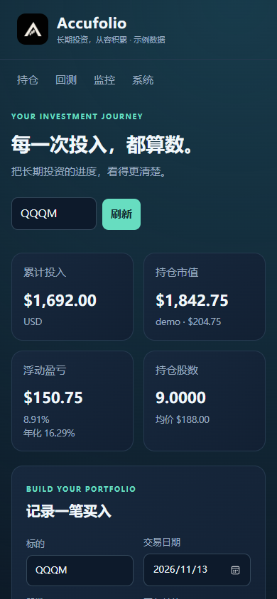
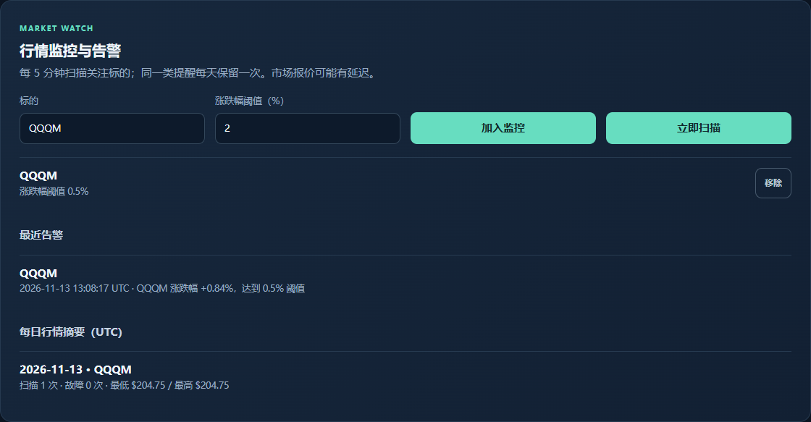

<div align="center">
  
  <h1>Accufolio</h1>
  <p><strong>长期投资，从容积累。</strong></p>
  <p>自托管的投资账本，帮你记录每一次投入，看清长期投资的进度。</p>
  <p>
    <a href="https://github.com/zuquanzhi/Accufolio/actions/workflows/ci.yml"></a>
    <a href="https://github.com/zuquanzhi/Accufolio/releases/latest"></a>
    <a href="LICENSE"></a>
  </p>
  <p><a href="#快速开始">快速开始</a> · <a href="#手机使用">手机使用</a> · <a href="guides/使用与部署.md">使用与部署指南</a> · <a href="https://github.com/zuquanzhi/Accufolio/releases">版本下载</a> · <a href="README.en.md">English</a></p>
</div>

---

Accufolio 面向长期定投者，提供买入记账、持仓分析、策略回测与行情监控。它是单用户、自托管应用：数据保存在自己的 SQLite 数据库中，可通过浏览器、PWA 或 Android 客户端访问。

## 产品预览

| 桌面 Web | 手机 Web / PWA |
|:---:|:---:|
|  |  |

<details>
<summary>查看更多：策略回测、行情监控和手机交易记录</summary>
<br>



</details>

预览来自实际运行的界面，使用独立数据库和模拟交易、行情数据；数值仅用于演示。手机图展示响应式网页，Android 客户端连接服务器后展示同一界面。

## 能做什么

- **记录与分析** — 维护买入记录，查看投入、持仓、均价、市值、盈亏和 XIRR；交易修改可审计、可撤销。
- **比较定投策略** — 粘贴日线收盘价，比较四种投入策略，查看期末资产、区间收益及标的收盘价最大回撤。
- **跟踪行情** — 使用新浪美股报价，配置关注列表和涨跌幅阈值，在应用内查看提醒与数据源状态。
- **掌控数据** — SQLite 本地存储、每日和手动备份、JSON 交易导出；支持本地 MCP 接入，默认只读。
- **跨设备访问** — 桌面浏览器、手机 PWA 和 Android APK 连接同一个自托管实例。

## 快速开始

需要 [Docker 和 Docker Compose](https://docs.docker.com/get-docker/)。在终端执行：

```bash
git clone https://github.com/zuquanzhi/Accufolio.git
cd Accufolio
cp .env.example .env
# 编辑 .env，设置唯一且足够强的 ACCUFOLIO_PASSWORD
docker compose up -d --build
```

打开 <http://127.0.0.1:8000>，使用默认用户名 `admin` 和刚设置的密码登录。没有默认密码。容器默认只监听本机，数据库保存在 Docker 卷中。

也可以使用 Python 3.11–3.13 运行。远程访问和手机连接需要先配置 HTTPS；完整步骤、环境变量、升级及备份恢复请参阅 **[使用与部署指南](guides/使用与部署.md)**。

## 手机使用

| 方式 | 适用情况 | 开始使用 |
|---|---|---|
| **Android APK** | Android 10 及以上 | 从 [最新 Release](https://github.com/zuquanzhi/Accufolio/releases/latest) 的 Assets 下载 `.apk`，安装后输入自托管实例的 HTTPS 根地址。 |
| **PWA** | Android 或 iOS 浏览器 | 打开 HTTPS 站点，通过浏览器菜单安装或添加到主屏幕。 |

APK 和 PWA 均需先部署服务器；APK 不内置后端。服务器更新后，网页功能会自动检测并加载；有未保存输入时会先提示。Android 原生客户端本身更新仍需安装新版 APK。Release 中的源码 ZIP 用于部署和开发，并非手机安装包；同时提供 SHA-256 校验文件。

## 工作原理

```text
浏览器 / PWA / Android 客户端
              │ HTTPS
              ▼
       FastAPI + Web 界面 ── 行情提供方
              │
        SQLite 数据库与备份
              ▲
       本地 MCP 客户端（可选）
```

应用使用 HTTP Basic 认证，公开网络访问时必须通过 HTTPS；请保护好密码和数据库备份。MCP 以本地进程运行，默认只读，写入需要显式开启。更多说明见[部署与 MCP 指南](guides/使用与部署.md)。

## 适用范围

当前版本专注单用户、USD 买入账本，不连接券商或执行交易。卖出、分红、手续费、多币种、券商同步和外部通知暂不支持。行情依赖第三方，可能延迟或不可用；回测忽略费用、税费和分红，历史表现不代表未来收益。

## 开发与验证

```bash
python -m venv .venv
# macOS / Linux: source .venv/bin/activate
# Windows PowerShell: .venv\Scripts\Activate.ps1
pip install -r requirements.txt
python -m unittest discover -s tests -v
```

CI 覆盖 Python 测试、浏览器流程、Docker 启动和 Android 测试；发布工作流验证通过后生成签名 APK、源码包及校验文件。浏览器回归、Android 构建、回测口径和贡献运行方式见[指南](guides/使用与部署.md)。欢迎通过 [Issues](https://github.com/zuquanzhi/Accufolio/issues) 反馈问题或提出建议。

## 许可证

[Apache License 2.0](LICENSE)
