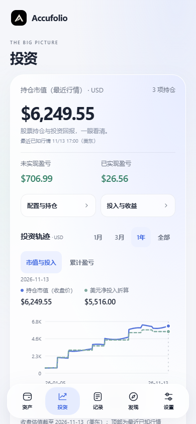
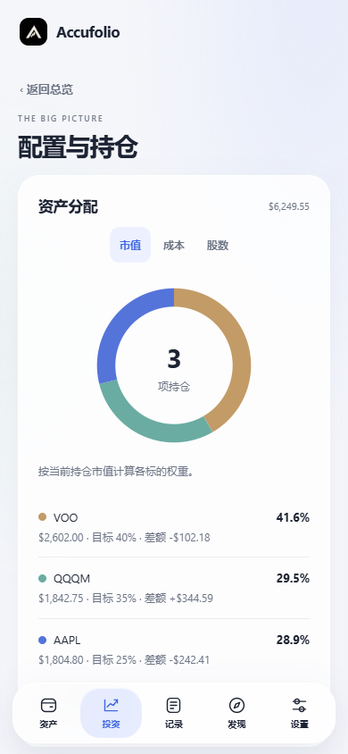
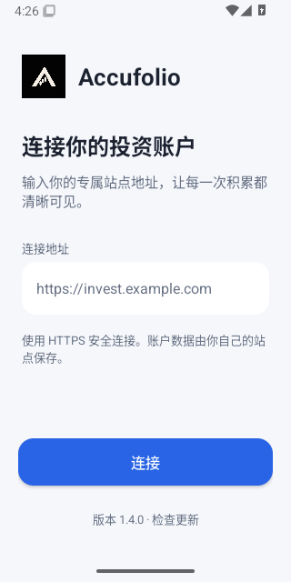

<div align="center">
  
  <h1>Accufolio</h1>
  <p><strong>Agent 驱动的资产配置看板</strong></p>
  <p>让 Agent 整理资产，用图表看清配置。</p>
  <p>
    <a href="https://github.com/zuquanzhi/Accufolio/actions/workflows/ci.yml"></a>
    <a href="https://github.com/zuquanzhi/Accufolio/releases/latest"></a>
    <a href="LICENSE"></a>
  </p>
  <p><a href="#工作方式">工作方式</a> · <a href="#快速开始">快速开始</a> · <a href="guides/使用与部署.md">部署与 MCP 指南</a> · <a href="https://github.com/zuquanzhi/Accufolio/releases">版本下载</a> · <a href="README.en.md">English</a></p>
</div>

---

Accufolio 是单用户、自托管的资产配置看板。账户说明钱放在哪里、用于什么；Agent 通过 MCP 维护现金流水和证券交易，余额、持仓、配置与收益由明细推导。

资产与交易记录在 Web、PWA 和 Android 中只读查看，数据保存在你自己的 SQLite 数据库。Accufolio 提供 MCP 工具与可视化界面；Agent 由你自行选择和运行，应用不内置 AI 模型或聊天服务。

## 产品预览


<details>
<summary>查看更多：资产配置、策略曲线、行情关注与移动端</summary>
<br>






</details>

宣传图使用实际运行界面截图和示意设备外框，交易与行情数据均为模拟数据。手机图展示响应式网页，Android 客户端连接服务器后展示同一界面；欢迎页来自 Android 15 模拟器。

## 资产与投资，各有重点

| 页面 | 看什么 |
|---|---|
| **资产** | 默认首页。净资产、明确的账户、现金余额与账户配置；点按账户核对流水。 |
| **投资** | 证券持仓、未实现与已实现盈亏、历史曲线；配置与持仓、投入与收益各有详情。 |
| **记录** | 已完成的证券买卖，包含账户、币种、手续费与策略标签。 |
| **发现** | 四种定投策略、分级提醒、退潮信号和可选 Webhook。 |
| **设置** | 展示币种、时区、登录、备份、连接和更新。 |

现金余额由流水累计，证券按账户与标的计算，再汇总展示；目标只存权重。支持 USD、人民币 CNY、HKD、EUR：当前金额使用最新参考汇率，历史点使用当时已发布的汇率。缺失行情或汇率时明确显示不可计算。

## 工作方式

自己的 Agent 先读取账户和明细，再预览已发生的资产操作，通过本地 MCP 写入 Web 服务使用的同一 SQLite 数据库。Web、PWA 和 Android 负责只读展示；应用不内置 AI 模型或聊天服务。

账户、现金、交易、配置目标与共享设置的写入默认预览，提交需开启 `ACCUFOLIO_MCP_SCOPE=write` 并设置 `dry_run=false`；版本检查、幂等键与审计保护提交过程。

> 请读取我的账户列表，预览如何记录这次工资入账，并保留原币金额和日期。

> 请整理这笔已成交的美股买入：确认所属券商账户、成交金额、手续费与策略，再分别核对交易和实际现金变动。

**交易记录不会自动结算现金。** Agent 需要依据真实资金变动分别维护现金流水，不能凭交易推测初始余额。跨账户转账和换汇通过专用工具成对、原子记录。MCP 目前需要本地访问同一数据库，不提供远程接入，详见 [MCP 指南](guides/使用与部署.md#mcp-接入)。

## 计算口径

净资产为证券市值与现金账户余额的统一币种合计；当前不建模负债。证券采用移动加权平均成本并纳入交易手续费。XIRR 明确为美元证券交易口径，不把现金账户利息、分红自动混入证券收益率。

最新行情与历史收盘估值分别标注时间。历史曲线使用美东已完成交易日的同日未复权价格，缺失保持断点，不是完整账户净值。ECB 历史汇率按日期保存，不用今天的汇率倒算过去。详见[数据模型与计算口径](guides/schema-v2.md)。

## 快速开始

需要 Docker Compose，或 Python 3.11–3.13。首次部署：

```bash
git clone https://github.com/zuquanzhi/Accufolio.git
cd Accufolio
cp .env.example .env
# 编辑 .env，设置唯一且足够强的 ACCUFOLIO_PASSWORD
docker compose up -d --build
```

打开 <http://127.0.0.1:8000>，使用用户名 `admin` 和所设密码登录。容器默认只监听本机；新库初始化最终表结构和一个空的 USD 券商账户，不写入示例余额、交易或汇率。

按 [MCP 指南](guides/使用与部署.md#mcp-接入)配置自己的 Agent，确保 `ACCUFOLIO_DB` 与 Web 服务指向同一个数据库。先调用 `list_accounts`、`get_assets`、`get_dashboard` 核对连接，再预览数据写入。

**2.0 使用新的账户与流水模型。** 最终表结构位于 [sql/schema.sql](sql/schema.sql)。已有数据库需由部署者先备份并自行适配；应用不会推测、迁移或改写旧账本，不兼容的旧库会拒绝启动。细节见[部署指南](guides/使用与部署.md)。

## 手机与更新

| 方式 | 使用方法 |
|---|---|
| **Android 10+** | 从 [最新 Release](https://github.com/zuquanzhi/Accufolio/releases/latest) 的 Assets 下载 `.apk`，安装后输入自己的 HTTPS 站点地址。 |
| **PWA** | 在 Android 或 iOS 浏览器打开 HTTPS 站点，安装或添加到主屏幕。 |

两者均需先部署服务器；APK 不内置后端。服务器更新后网页自动检测新版本并保护未保存输入。原生更新可在应用内下载、校验并交由 Android 系统确认安装；源码 ZIP 不是手机安装包。

设备可保持登录最长 90 天，保存可撤销令牌，不保存密码；退出或更换站点密码会使相应会话失效。远程访问须使用 HTTPS。已有反向代理需设置 `ACCUFOLIO_PUBLIC_ORIGIN`，附带 Caddy 配置会自动设置。

## 数据与边界

服务端提供 SQLite 在线备份和账户、流水等业务数据的 JSON 导出。自动日备份默认保留 30 份；后台心跳、失败与投递状态可查看，告警清理保护未送达消息。数据权限与运行 MCP 的本地进程绑定。

当前支持 USD 美股交易、原币现金账户和四种展示币种；未覆盖的币种显示折算不可用。现金可记录利息、分红和费用，证券 XIRR 暂不纳入现金分红。未复权日线可能受拆股影响。不连接券商下单，不提供多用户、远程 MCP 或行情分销；独立离线启动、完整账户净值和负债管理未实现。更多边界见[路线图](guides/roadmap.md)。

## 开发与验证

```bash
python -m venv .venv
# macOS / Linux: source .venv/bin/activate
# Windows PowerShell: .venv\Scripts\Activate.ps1
pip install -r requirements.txt
python -m unittest discover -s tests -v
```

CI 配置涵盖 Python、浏览器流程、Docker 和 Android 检查；验证成功的发布包含签名 APK、源码包和 SHA-256 校验文件。具体结果见对应提交的 [Actions](https://github.com/zuquanzhi/Accufolio/actions)。欢迎通过 [Issues](https://github.com/zuquanzhi/Accufolio/issues) 反馈问题。

## 许可证

[Apache License 2.0](LICENSE)
